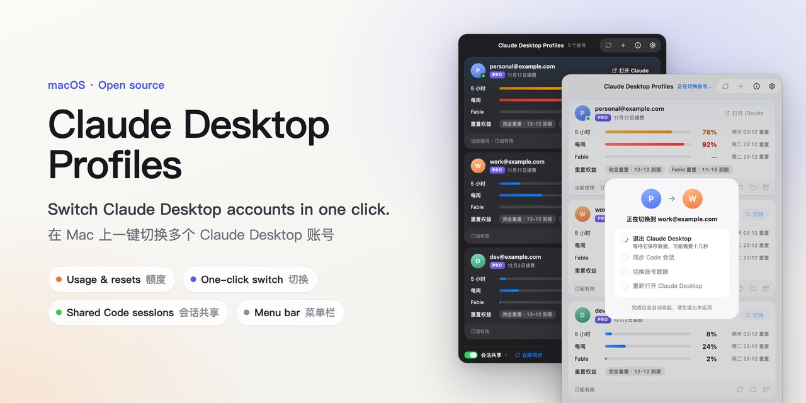

# Claude Desktop Profiles

A menu bar app for people with several Claude Desktop accounts: see each account's usage and resets, switch accounts with one click, and share Claude Code sessions across them.

- platforms: macOS
- source: https://github.com/gopkg-dev/claude-desktop-profiles
- author: gopkg-dev

